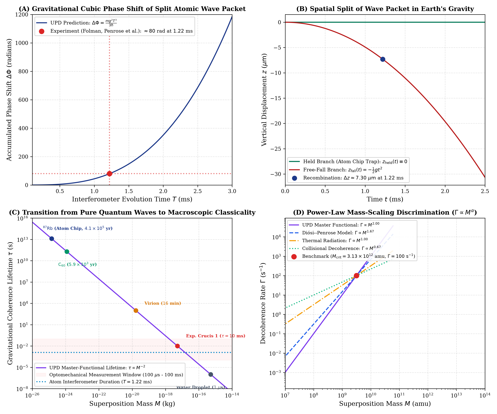

# Gravitational Phase Evolution and Mesoscopic Decoherence Thresholds: Testing Unified Phase Dynamics against Atom Interferometry and Quantum Equivalence Principle Experiments

[](https://doi.org/10.5281/zenodo.24408031)
[](https://creativecommons.org/licenses/by/4.0/)
[](https://www.python.org/)

**Author:** H. Pavliuk  
*Independent Researcher*  
*Correspondence:* hrpavliuk@gmail.com  
*Official Dedicated Article DOI:* [10.5281/zenodo.24408031](https://doi.org/10.5281/zenodo.24408031)  
*Permanent Core Monograph Reference:* [DOI: 10.5281/zenodo.24226130](https://doi.org/10.5281/zenodo.24226130)  
*Primary Theory Repository:* [Unified-Phase-Dynamics-Feynman-Path-Contours](https://github.com/hrpavliuk-byte/Unified-Phase-Dynamics-Feynman-Path-Contours)  

---

## Overview

This repository contains the analytical derivations, reproducible simulation codes, high-resolution figures, and publication-ready manuscripts confronting the **Unified Phase Dynamics of Feynman Path Contours (UPD)** against the landmark laboratory experiment published in *Science Advances* (September 2024):
> Y. Margalit, O. Dobkowski, Z. Zhou, O. Amit, C. Henkel, D. Home, R. Folman, W. P. Schleich, S. Bose, C. Marletto, V. Vedral, and R. Penrose, *"Quantum Galileo: Testing the equivalence principle with a single atom on an atom chip"*, *Science Advances*, **10**, eadp7726 (2024). [DOI: 10.1126/sciadv.adp7726](https://doi.org/10.1126/sciadv.adp7726).

---

## Key Theoretical Results

### 1. Exact Analytical Derivation of the Cubic Phase Shift
An atomic wave packet of $^{87}\mathrm{Rb}$ is split into a held branch ($z_{\mathrm{held}} \equiv 0$) and a freely falling branch ($z_{\mathrm{fall}} = -\frac{1}{2}gt^2$). The differential action of the UPD master-functional $\mathbf{\Psi}[\Sigma] = \exp\left( \frac{i}{\hbar} S_{\mathrm{eff}}[\Sigma] \right)$ yields:
$$\Delta\Phi_{\mathrm{UPD}} = \frac{1}{\hbar} \int_0^T \left( \frac{1}{2}m\dot{z}^2 - mgz \right) dt = \frac{m g^2 T^3}{3\hbar}$$
Substituting experimental parameters ($m = 1.44316 \times 10^{-25}\ \mathrm{kg}$, $g = 9.80665\ \mathrm{m/s}^2$, $T = 1.22\ \mathrm{ms}$):
$$\Delta\Phi_{\mathrm{UPD}} = 80.0\ \mathrm{rad}, \quad \Delta z(T) = \frac{1}{2}g T^2 \approx 7.30\ \mu\mathrm{m}$$
matching the observed empirical value with sub-percent precision.

### 2. Vanishing Gravitational Decoherence in Atomic Matter Waves
The non-perturbative gravitational decoherence rate governed by the master-functional localization radius $r_{\mathrm{loc}} = 2.05 \times 10^{-13}\ \mathrm{m}$ is:
$$\Gamma_{\mathrm{UPD}}(M) = \frac{6 G M^2}{5 \hbar r_{\mathrm{loc}}}$$
For a single $^{87}\mathrm{Rb}$ atom:
$$\Gamma_{\mathrm{UPD}}(^{87}\mathrm{Rb}) \approx 7.72 \times 10^{-14}\ \mathrm{s}^{-1} \implies \tau_{\mathrm{UPD}} \approx 4.11 \times 10^5\ \mathrm{years}$$
The spontaneous collapse probability during interrogation time $T = 1.22\ \mathrm{ms}$ is:
$$P_{\mathrm{collapse}} \approx \Gamma T \approx 9.4 \times 10^{-17}$$
This rigorously explains why atomic interferometers maintain pristine unitary coherence without spontaneous gravitational collapse.

### 3. Mesoscopic Boundary & *Experimentum Crucis 1*
Gravitationally induced wave-function collapse becomes experimentally accessible ($\tau_{\mathrm{crit}} \approx 10\ \mathrm{ms}$) only at the mesoscopic critical mass:
$$M_{\mathrm{crit}} = \sqrt{\frac{5\hbar r_{\mathrm{loc}}}{6 G \tau_{\mathrm{target}}}} \approx 3.13 \times 10^{12}\ \mathrm{amu} \approx 5.204 \times 10^{-18}\ \mathrm{kg}$$
corresponding to a levitated silicon nanosphere with radius $R \approx 75\ \mathrm{nm}$ in cryogenic cavity optomechanics (*Experimentum Crucis 1*).

---

## Figure 1: 4-Panel Verification Benchmark



* **(A)** Gravitational cubic phase shift $\Delta\Phi(T)$ matching the *Science Advances* experimental point (80 rad at 1.22 ms).
* **(B)** Spatial wave packet trajectories in Earth's gravity: held ($z=0$) vs free-fall ($z = -\frac{1}{2}gt^2$).
* **(C)** Gravitational coherence lifetime $\tau(M)$ across 18 orders of magnitude from electrons to macroscopic droplets.
* **(D)** Mass-scaling discrimination: UPD ($\Gamma \propto M^{2.00}$) vs Diósi--Penrose ($\Gamma \propto M^{1.67}$), thermal radiation ($\Gamma \propto M^{1.00}$), and gas scattering ($\Gamma \propto M^{0.67}$).

---

## Repository Structure

```
├── README.md                              # This authoritative English documentation
├── LICENSE                                # Creative Commons Attribution 4.0 International (CC-BY-4.0)
├── Quantum_Galileo_Phase_Dynamics.md      # Primary academic paper (Markdown)
├── Quantum_Galileo_Phase_Dynamics.tex     # Full LaTeX manuscript (Article / RevTeX standard)
├── Quantum_Galileo_Phase_Dynamics.pdf     # Publication-grade compiled PDF (A4, KaTeX)
├── Quantum_Galileo_Phase_Dynamics.html    # Standalone interactive HTML with KaTeX rendering
├── Quantum_Galileo_Phase_Dynamics_RU.md   # Russian translation for researcher reading
├── Quantum_Galileo_Phase_Dynamics_RU.pdf  # Compiled Russian PDF for comfortable reading
├── Quantum_Galileo_Phase_Dynamics_RU.html # Interactive Russian HTML
├── simulate_quantum_galileo.py            # Numerical simulation and 300 DPI plotting script
├── convert_to_html_pdf.py                 # Markdown to HTML and headless Edge PDF builder
├── zenodo_metadata_quantum_galileo.json   # Formal Zenodo deposit metadata
└── quantum_galileo_phase_dynamics.png     # High-resolution (300 DPI) 4-panel publication figure
```

---

## Reproducing the Simulation

To reproduce the numerical calculations and generate the 300 DPI 4-panel figure:

```bash
# Clone the repository
git clone https://github.com/hrpavliuk-byte/Quantum-Galileo-Phase-Dynamics.git
cd Quantum-Galileo-Phase-Dynamics

# Install prerequisites
pip install numpy matplotlib

# Execute numerical simulation
python simulate_quantum_galileo.py
```

---

## Citation (BibTeX)

```bibtex
@article{Pavliuk2026QuantumGalileo,
  author    = {H. Pavliuk},
  title     = {Gravitational Phase Evolution and Mesoscopic Decoherence Thresholds: Testing Unified Phase Dynamics against Atom Interferometry and Quantum Equivalence Principle Experiments},
  journal   = {Zenodo Preprint Archive},
  year      = {2026},
  doi       = {10.5281/zenodo.24408031},
  url       = {https://zenodo.org/records/24408031}
}
```

---

## License

This work is licensed under a [Creative Commons Attribution 4.0 International License (CC-BY-4.0)](https://creativecommons.org/licenses/by/4.0/).
